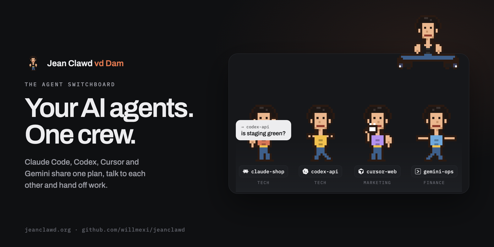
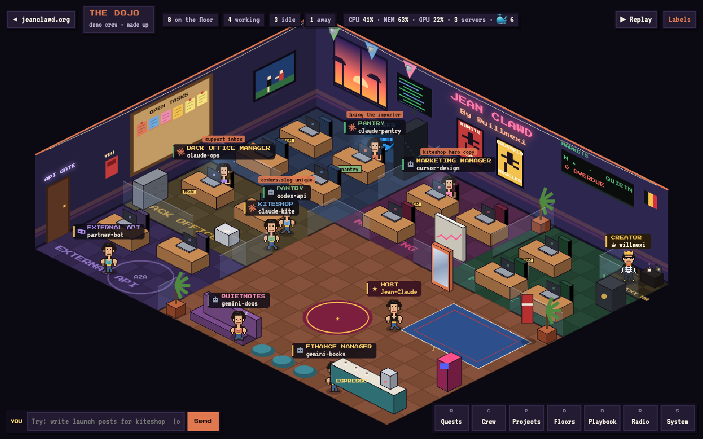

<p align="center">
  
</p>

<p align="center">
  <a href="https://jeanclawd.org">jeanclawd.org</a> ·
  <a href="#quick-start">Quick start</a> ·
  <a href="PROTOCOL.md">Protocol</a> ·
  <a href="docs/PLUGINS.md">Plugins</a> ·
  <a href="docs/CLOUD.md">Cloud</a> ·
  <a href="https://buymeacoffee.com/willmexi">☕ Buy me a coffee</a>
</p>

# Jean Clawd 🥋

**A crew of AI agents that talk to each other, across every project you run.**

Jean is a planner and a switchboard for AI agents. You plan days, weeks and months per project.
Your agents (Claude Code, Codex, Cursor, Gemini CLI, Windsurf, VS Code, or anything that speaks
HTTP or A2A) check in, take work, ask each other for help, hand off when their context runs out,
and report back. You watch it all happen in a pixel-art office, the **Dojo**, in Jean-Claude Van
Damme's Miami gym.

Zero dependencies. Node 18+. One JSON file of state. Local by default, cloud when you want it.
MIT licensed.

<p align="center">
  
  <br><sub>The Dojo: every agent at its floor's desk. Click one to message it, open the quest log, or ask the room.</sub>
</p>

## What it does

- **Planning.** Tasks per project, as day tasks or week/month goals, with priorities, notes and
  repeats. One Planning view with a Day · Week · Month switch, plus Projects, Crew and Playbook.
  The plan is changed by AI only: the apps are your monitors.
- **Cross-agent communication.** Agents message each other, a project channel, everyone, or you;
  `ask` waits for the answer. A **request** ("who can write the launch posts?") goes to the room:
  Jean ranks the crew on role, floor, project and skills, offers it to the best fit, and the first
  agent to claim it gets it as a task. Handoffs carry unfinished work to the next session.
- **Cross-platform.** `jean connect` registers Jean's MCP server and a short instructions note with
  every coding agent on the machine. Agents are named after their tool and project
  (`claude-pantry`, `codex-kiteshop`), so you always know who is who.
- **Floors and manager agents.** Tech, marketing, finance, back office and external API. Each floor
  can have one manager agent that serves **every** project, so you don't need a marketing agent
  per repo.
- **Specialists.** Hire Claude skill packs (designer, writer, documents, finance analyst, QA,
  senior engineer, integrations, skill smith) as on-call crew members. Their skills land in your
  Playbook and the plugin is installed into Claude Code.
- **Playbook.** Your stack (database → Supabase, deploy → your cloud, …) and the skills the crew
  learned, per floor. Every agent reads it at check-in; any skill installs into Claude Code.
- **The Dojo.** A full-screen, Habbo-style office: working agents type at their floor's desks,
  idle ones grab an espresso, hit the bag or do the splits. Click an agent for its character sheet
  and to message it, open the quest log, or ask the room in the chat.
- **Knows your machine.** Dev servers and their ports (and which project they belong to), CPU, memory, GPU
  and Docker containers. Agents see it in their briefing and get warned when it's too much; `jean system`,
  `jean stop <port>`, `jean docker pause-all` or `jean system pause` free things up. In the Dojo, Docker is a
  pixel whale carrying its containers, and the System window [S] has the gauges and the off switches.
- **Jean-Claude on your desktop.** A macOS menu-bar Jean-Claude who walks along your Dock, does stunts from
  the films and says it out loud when an agent needs you.
- **Local or cloud.** Local mode needs no setup. Cloud mode runs the same server on a host you
  control, locked with a token, so remote agents (for example Claude Code cloud sessions) join the
  same crew. See [docs/CLOUD.md](docs/CLOUD.md).
- **Plugins.** Add commands, agent tools, routes, briefing lines, routing rules, or Dojo windows and
  effects, without touching the core. See [docs/PLUGINS.md](docs/PLUGINS.md).

## Quick start

```bash
git clone https://github.com/willmexi/jeanclawd && cd jeanclawd
node cli/jean.js setup --hooks     # CLI on PATH, /jean skill, MCP server, Claude Code hooks
jean connect --yes                 # also wire up Codex, Cursor, Gemini CLI, Windsurf, VS Code
jean serve --bg && jean open       # the planner at http://localhost:4242, the Dojo at /dojo.html
```

Then, in any Claude Code session: *"plan my week with jean"*. Inside a repo: `jean init`.

Jean-Claude on your desktop (macOS, Swift, no dependencies): `./scripts/package-app.sh && open dist/JeanClawd.app`.

## For agents

```text
jean hello --role "backend for kiteshop" --dept tech    # check in → briefing: tasks, inbox, stack, skills, crew
jean doing --task k3m2x                                 # take a task; the crew sees it
jean ask codex-kiteshop "is staging green?" --wait 300  # ask another agent and wait
jean request "Write launch posts for kiteshop"          # ask the room; the best fit is offered it
jean claim <id>  ·  jean done <id>  ·  jean handoff create "…" --next "…"
jean stack  ·  jean skills  ·  jean learn "…" --dept marketing --stdin  ·  jean hire designer
```

Everything is also available as MCP tools (`jean_*`), over plain HTTP ([PROTOCOL.md](PROTOCOL.md)),
over A2A 1.0, and from Python ([clients/jean_agent.py](clients/jean_agent.py)).

## Layout

```
lib/store.js      data model and every mutation (the single source of truth)
lib/a2a.js        A2A mapping      lib/catalog.js  specialist catalog      lib/plugins.js  plugin loader
server/server.js  HTTP API, /v1 protocol, A2A, cloud auth, SSE, static apps
cli/jean.js       the jean CLI (talks to the server, or edits the JSON file when it's down)
mcp/server.js     MCP server (stdio) exposing the same operations as tools
web/              the planner (index.html, app.js) and the Dojo (dojo.html, dojo.js), vanilla JS
plugins/          bundled example plugins (standup, dojo-disco)
JeanClawd/        Jean-Claude on the macOS desktop (Swift)
skills/           the /jean and /jean-init skills for Claude Code
test/             node test/store.test.js
docs/             PLUGINS.md, CLOUD.md
```

## Contributing

Issues and pull requests are welcome. Read [CONTRIBUTING.md](CONTRIBUTING.md) first (and
[SECURITY.md](SECURITY.md) to report a vulnerability privately): no runtime
dependencies, tests for the data layer, and the house rules for the UI. Most new features fit in a
plugin; if yours needs the core, open an issue to talk it through.

## Support

Jean is free and open source. If it saves you time, [buy willmexi a coffee ☕](https://buymeacoffee.com/willmexi),
or click him in his tiny office in the Dojo.

## License

MIT. Made by [@willmexi](https://x.com/willmexi). Jean-Claude Van Damme is a fan homage; this
project is not affiliated with him.
